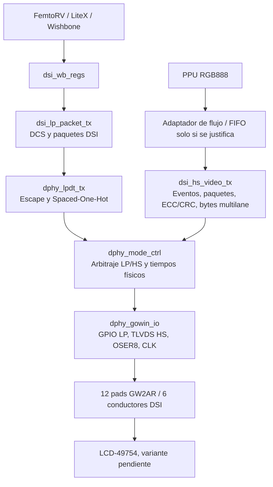

# FPGBC — Arquitectura objetivo de un host MIPI DSI TX

**Estado:** propuesta técnica para revisión; NO equivale a diseño aprobado ni validación eléctrica.
**Fecha de elaboración:** 2026-11-08.
**Repositorio de destino:** https://github.com/digital-un-2026-2/FPGBC_pantalla
**Regla:** documentar protocolo -> algoritmo -> datapath -> FSM -> verificación -> RTL, en ese orden.

## 0. Procedencia, alcance y límites de la auditoría

**[U] Información del propietario del proyecto:** FunnyPlaying FPGBC, GW2AR-LV18EQ144PC8/I7, FemtoRV/LiteX/Wishbone, pantalla de familia LCD-49754, 720x720, RGB888, dos data lanes, un clock lane, doce pads conectados mediante seis conductores con dos ramas por conductor. No hay RESET físico LCD accesible. La identificación de variante exacta de LCD y sus comandos/temporizaciones no está cerrada.

**[R] Repositorio público inspeccionado documentalmente:** `README.md`, `motor_lpdt/README.md`, `docs/arquitectura.md`, `docs/hardware.md`. El repositorio describe un motor LPDT con pruebas Icarus, control en posedge y datapath en negedge a 40 MHz, longitud de 1–7 bytes, temporizaciones fijas y pendientes de HS, integración y evaluación eléctrica. **No se descargaron ni inspeccionaron directamente los archivos fuente Verilog o testbenches individuales; no se ejecutaron pruebas.** Codex DEBE hacer la auditoría en su entorno antes de proponer reutilización específica de bloques.

**[F] Referencias externas:** Gowin IPUG112 §4.2 y Fig. 4-3; IPUG948 §4.2 y Fig. 4-3; UG289 §3.6.7, §4.3.4; MIPI D-PHY / DSI / DCS; referencia abierta zoatel/MIPI-D-PHY como material de estudio, no implementación validada para FPGBC. Ver bibliografía al final.

**[P] Propuesta de diseño:** los módulos, interfaces, etapas de migración, mapa de registros y criterios de pruebas siguientes son especificaciones de trabajo, no confirmaciones de que el RTL ya los implemente.

## 1. Objetivos y exclusiones

### Objetivos de la primera arquitectura

1. Enviar comandos DCS desde firmware FemtoRV por Wishbone sin exponer señales eléctricas al software.
2. Construir paquetes DSI short y long cuando estén justificados por la inicialización del panel.
3. Emitir LPDT TX por D0 con entrada/salida Escape, símbolo a símbolo y temporización verificable.
4. Compartir una única PHY entre comandos LPDT y vídeo HS: un solo árbitro de modos y un solo adaptador de pads.
5. Transportar RGB888 de la PPU con definición exacta de orden de bytes, eventos de línea/cuadro y presupuesto de ancho de banda.
6. Transmitir vídeo HS por D0+D1, con reloj HS y serialización compatibles con GW2AR.
7. Demostrar cada capa en simulación antes de conectar el panel y validar físicamente cualquier configuración de salida.

### Fuera de alcance inicial

RX, BTA, lecturas DCS, ULPS, doble controlador de pads, framebuffer no justificado, control físico de RESET LCD inexistente, substitución obligatoria por IP comercial cifrada. Si el LCD exige alguna de estas funciones, el requisito bloquea el alcance: no se disfraza con un parche.

## 2. Mapa de capas

Este diagrama expresa propiedad funcional. En hardware, `dphy_mode_ctrl` arbitra y controla habilitaciones; los datos del packetizer LP y del sistema HS pueden entrar a `dphy_gowin_io` como señales distintas o mediante selección controlada. **No se debe interpretar que toda la carga de vídeo atraviesa en serie la lógica de la FSM de modos.**

### Principio de propiedad exclusiva

- `dsi_lp_packet_tx`: **bytes DSI**, no voltajes ni Escape.
- `dphy_lpdt_tx`: **símbolos LPDT**, no ECC ni DCS.
- `dsi_hs_video_tx`: **secuencia DSI de vídeo + bytes agregados de lanes**, no GPIO.
- `dphy_mode_ctrl`: **estado físico, concesiones y habilitaciones LP/HS**, no paquetes ni píxeles.
- `dphy_gowin_io`: **primitivas y pads**, no decisiones protocolarias.
- `dsi_wb_regs`: **registro/snapshot/peticiones de control**, no temporización LP/HS.

## 3. Módulos y contratos propuestos

### 3.1 `dsi_tx_top` — integración estructural

Conecta bloques sin duplicar FSM. Exporta: interfaz Wishbone, interfaz PPU por definir, referencias de reloj/reset y señales de pads en un top específico de Gowin. Todos los clocks y resets se enumeran en un documento de dominios. Ningún pin se asigna por simple orden de vectores sin tabla explícita de P/N.

**Aceptación:** elaborated RTL; ninguna salida tiene más de un propietario lógico; las primitivas sólo viven en el adaptador de hardware.

### 3.2 `dsi_wb_regs` — puente de comandos del firmware

Entrada: Wishbone (forma exacta y dirección base de LiteX por integrar); reset de su dominio. Salida **propuesta**: descriptor inmutable `{vc,dt,cmd,param,payload_len}`, `cmd_req_valid`, `cmd_req_ready`, flujo de datos de payload o almacén transaccional, `video_enable_req`; respuesta `busy`, `done`, `error`, `error_code` y estados del link. No se permite sobrescribir un descriptor activo.

Modelo recomendado: firmware escribe datos y metadatos, un comando START copia de registros de preparación a registros activos, y el motor toma control de la transacción. `DONE` significa *transmisión local completa*, jamás confirmación del LCD. El firmware gestiona esperas DCS; tiempos y orden de inicialización quedan pendientes del panel real.

**Mapa tentativo, NO aprobado:** `0x00 CONTROL` (start, video_enable); `0x04 STATUS` (busy, done sticky, error sticky, phy_ready); `0x08 CMD_META` (DT, VC, tamaño); `0x0C CMD_ARG0` (DCS comando y primer parámetro); `0x10 CMD_DATA` (push de bytes si long packet está habilitado); `0x14 ERROR/IRQ_STATUS` (limpiar por escritura según especificación posterior). Anchos y semántica exacta se negocian con LiteX y sólo se congelan tras revisión.

**Pruebas:** write-while-busy, START duplicado, lectura de flags, reset durante transmisión, transacción rechazada por descriptor incompleto, tiempos de ACK/STALL si aplica al bus real.

### 3.3 `dsi_lp_packet_tx` — packetizer de comandos

Entrada: descriptor transaccional, payload y `ready` hacia el receptor; salida: `byte_valid`, `byte_ready`, `byte_data[7:0]`, `packet_last`, `done/error` según contrato aprobado. No administra los pads.

**Versión inicial:** DCS Short Write `DT=0x05` y DCS Short Write con un parámetro `DT=0x15`, virtual channel VC=0 inicialmente. Cabecera corta: `[Data ID][Data0][Data1][ECC]`. DCS `Software Reset` usa comando `0x01`. El repositorio documenta el vector LPDT completo `87 05 01 00 10`; en la separación propuesta **el packetizer produce sólo `05 01 00 10`** y el motor D-PHY genera el Escape Command `0x87`. El agente deberá verificar qué hace el RTL legado antes de modificarlo.

**Versión condicionada:** DCS Long Write `DT=0x39` y Generic Writes necesarios para el panel. Formato `[Data ID][WC_L][WC_H][ECC][payload: WC bytes][CRC_L][CRC_H]`; `WC` cuenta bytes, no píxeles. ECC de los tres primeros bytes de cabecera y CRC del payload, según variante de estándar aplicable. No inventar polinomios, orden de bits, valores de prueba o comandos de inicialización: obtener vectores independientes y documentar su fuente.

**Pruebas:** ECC por vectores, orden byte/bit, VC, 0/1/max bytes (según soporte), prohibición de empezar short write sin descriptor completo, `ready=0` sin pérdida ni repetición, payload inmutable durante envío.

### 3.4 `dphy_lpdt_tx` — máquina física LPDT de D0

Entrada lógica: flujo de **bytes DSI ya empaquetados** y señal de concesión exclusiva de D0 de `dphy_mode_ctrl`. Salida: `lp_d0_state[1:0]` (bit 1=P, bit 0=N) más evento de término local. En LPDT, D1 y CLK permanecen LP-11 bajo control del módulo de modo/adaptador, no del packetizer.

Secuencia física objetivo, pendiente de correlacionar con versión normativa D-PHY:

- Stop State `LP-11`.
- Escape Entry `LP-10 → LP-00 → LP-01 → LP-00`.
- Escape Command de LPDT `0x87`, con orden de bits definido por D-PHY (LSB first).
- Datos codificados con símbolos Spaced-One-Hot: bit cero `LP-01 → LP-00`; bit uno `LP-10 → LP-00`.
- Escape Exit/Mark-1 y retorno a LP-11.

Datapath mínimo **a demostrar antes de escribir**: registro de ocho bits, contador de bits, índice de entrada Escape, fase Mark/Space, temporizador parametrizable, codificador combinacional de símbolos. Una FSM principal para la transacción; no una FSM por bit.

Temporización: para frecuencia `f_lp` y duración exigida `t_req`, definir `N=ceil(t_req*f_lp)` y demostrar para **cada intervalo** qué mínimo/tolerancia aplica. A 40 MHz cada ciclo completo son 25 ns; no heredar automáticamente los cuatro ciclos por símbolo del motor legado. Si se decide trabajar con un solo flanco, preservar temporalmente un wrapper de compatibilidad y pruebas de equivalencia.

**Pruebas:** secuencia completa independiente de contadores internos, respuesta a `ready=0`, `reset`, longitud mínima/máxima, pulso único `done`, `busy` desde aceptación hasta Stop State, ausencia de nueva aceptación durante busy, no doble envío si request queda alto.

### 3.5 `dphy_mode_ctrl` — árbitro único y controlador de entrada/salida HS

Entrada: solicitudes `lp_req/hs_req`, `lp_done/hs_done`, estado `pll_locked`, y confirmaciones internas. Salida: concesiones diferenciadas (`lp_grant`, `hs_grant`) y controles eléctricos (`clk_hs_enable`, `data_hs_enable`, `lp_drive_*`, o su equivalente con polaridades aclaradas). Los grants NO equivalen al instante de activar el buffer.

Estados conceptuales propuestos: `SAFE_IDLE_LP11`, `LPDT_OWNED`, `HS_CLK_PREPARE`, `HS_DATA_PREPARE`, `HS_TRANSFER`, `HS_DATA_TRAIL`, `HS_CLK_TRAIL`, `RECOVERY/ERROR`. Se podrán fusionar o dividir solamente después de la tabla de operaciones, temporizadores y transiciones; no son una plantilla de RTL obligatoria.

Reglas: prohibir LPDT mientras se prepara o usa HS; permitir entrada HS sólo con PLL, datos preparados y reposo físico; reloj y datos HS no tienen la misma línea temporal; gestionar HS-Zero/Prepare/Trail/Exit según documentos aplicables; abortos no generan `done` de éxito; salida segura ante reset interno. La política de clock lane (continua/no continua) se decide según el LCD real.

**Pruebas:** exclusión de propietarios, secuencia de buffer OE, PLL se pierde antes/durante HS, reset, peticiones simultáneas, tiempo LP11 de reposo, imposibilidad de interrupción HS dentro de un payload.

### 3.6 `dsi_hs_video_tx` — jerarquía de vídeo HS

El nombre puede albergar temporalmente funciones internas sin forzar archivos/módulos adicionales:

1. Adaptación de PPU: `pixel_valid`, `pixel_ready` sólo si la PPU puede detenerse, `pixel_rgb[23:0]`, `line_start/end`, `frame_start/end` o señales reales de sincronismo; contrato por auditar.
2. Temporización y agenda de paquetes: definir de forma coherente Video Mode o Command Mode; sincronización, blanking, número/tipo de paquetes y ventana HS a partir del panel real. No asumir Video Burst automáticamente.
3. Packetizer DSI vídeo: cabeceras, tipos de datos, ECC, CRC, orden RGB888. Para vídeo RGB888 se estudia `DT=0x3E`, sujeto al modo seleccionado.
4. Empaquetado a dos lanes: stream agregado **16 bits/ciclo de byte HS**, dos octetos consecutivos `lane0=byte[7:0]`, `lane1=byte[15:8]` según el orden aprobado; añadir máscara `keep[1:0]` cuando exista un último beat parcial. La asignación por posición y el orden de bits deben probarse independientemente.
5. Acople a PHY HS y salida: una vez iniciado un burst, no se debe introducir una burbuja arbitraria en el flujo serial por `ready=0`. Hacer prefetch, aplicar una FIFO de profundidad justificada o demostrar garantía de tasa de entrada.

**Importante:** una interfaz `valid/ready` puede absorber stalls *antes de comenzar HS*, pero no autoriza detener la serialización en mitad de un paquete sin una política específica respaldada por DSI. Si la PPU no puede aplicar backpressure, especificar la política de sub/sobrecarga y presupuestar almacenamiento/latencia por línea.

**Pruebas:** patrón de píxeles diferenciables, CRC/ECC sobre paquetes reales, distribución D0/D1, start/end, underflow, overflow, ausencia de pérdidas/reordenamientos, sincronización por línea/cuadro y continuidad HS.

### 3.7 `dphy_gowin_io` — frontera física única

Único módulo donde se permiten primitivas Gowin (`TLVDS_TBUF`, `OSER8`, GPIO/TBUF y otras confirmadas). No es un segundo controlador D-PHY. Adaptar explícitamente el OEN **activo en bajo** de TLVDS_TBUF: en UG289 §3.6.7 `OEN=0` habilita la salida; no inferirlo desde el nombre de una señal arbitraria. `OSER8`: UG289 §4.3.4 describe D0..D7, PCLK/FCLK/RESET y Q0/Q1; `f_PCLK` suele ser `f_FCLK/4` en el ejemplo; verificar la implementación exacta, `TX*` y el orden serie en librería Gowin.

Durante LPDT: la salida HS debe estar deshabilitada; GPIO LP de D0 genera niveles individuales, CLK y D1 quedan LP-11. Durante HS: validar la topología TLVDS de Gowin, en la que GPIO LP pueden conducir a cero para dividir tensión y establecer modo común; no imponer triestado genérico a LP mientras se usa HS. **Ninguna combinación de conducción incompatible está permitida.**

La Fig. 4-3 de IPUG112/IPUG948 es una **referencia**, no una validación de la PCB del propietario. `VCCIO` del banco LP (~1.21 V según contexto del propietario, ~1.30 V según docs/hardware.md), y el de HS (~2.52 V) no son amplitudes HS; discrepancia LP por resolver.

**Pruebas/gates:** simulación de modo con modelos de pads; síntesis y P&R en `GW2AR-LV18EQ144PC8/I7`; comprobación de pines, pares P/N, OEN, niveles; revisar voltajes y medir en hardware con instrumentación apropiada **antes** de conectar el LCD.

### 3.8 `clock_reset` — únicamente si es necesario

Reusar PLL/relojes LiteX/Gowin existentes cuando sea posible. Documentar dominios `wb_clk`, `lp_clk` (actualmente 40 MHz en el periférico legado), `pixel_clk`, `hs_byte_clk`, `hs_fast_clk` y señales de fase. Cada cruce necesita prueba de que es síncrono, sincronizador de control o FIFO asíncrona correctamente dimensionada. Asserts y resets internos son por dominio; **no hay control de RESET físico LCD**.

## 4. Asignaciones eléctricas fijadas por el propietario [U]

| Conductor | GPIO LP (resistencia serie 100 Ω) | Pad HS directo |
|---|---:|---:|
| CLK_N | 128 | 112 |
| CLK_P | 126 | 113 |
| D1_N | 125 | 114 |
| D1_P | 124 | 115 |
| D0_N | 123 | 116 |
| D0_P | 122 | 117 |

Pares HS: CLK P=113/N=112; D1 P=115/N=114; D0 P=117/N=116. Referencias de parejas aportadas por el propietario: CLK IOT48A/B; D1 IOT42A/B; D0 IOT40A/B. **Son pines de encapsulado, no contactos del LCD.** No reasignar pines. Verificar con pinout y herramienta Gowin antes de generar constraints; la conexión física de PCB viene del seguimiento del propietario y no se establece por mero pinout.

No colocar un RESET LCD ficticio, ni interpretar las seis resistencias serie como resistencias de terminación entre P y N. No alterar la placa sin revisión.

## 5. Relojes, caudal y memoria

Datos activos de una imagen RGB888: `720*720*3=1_555_200 bytes/cuadro` (`12_441_600 bit/cuadro`). Dos lanes HS de tasa de línea `R_lane` aportan, idealmente, `2*R_lane/8 bytes/s` de payload agregado **antes** de overhead. En formato 8:1 cada lane consume un byte por ciclo `hs_byte_clk=R_lane/8`; ambas lanes juntas consumen 16 bits por ciclo.

Tasa media **de sólo datos activos**: `R_lane_activo = 720*720*24*fps/2`. Ejemplos **hipotéticos, no parámetros del panel**: 30 Hz => 186.624 Mb/s por lane; 60 Hz => 373.248 Mb/s por lane. Estos resultados excluyen cabeceras, CRC, blanking, eventos DSI, tiempos de HS entry/exit, clock lane y ocupación de enlaces. **No elegir PLL ni frecuencia HS con estos valores solos.**

Por línea activa: `720*3=2_160 bytes` de píxeles; una única transacción larga de ese payload contiene además 4 bytes de header y 2 de CRC en el formato convencional, sin contar otros paquetes. El presupuesto real debe hacerse por línea:

`B_line_total = B_active + B_headers + B_CRC + B_sync_blank + otros`.

`R_lane_min >= 8*B_line_total / (2*T_HS_disponible_por_linea)`.

Se debe verificar que el panel recibe el modo seleccionado y que `T_HS_disponible_por_linea` cuenta entradas/salidas de HS y eventos. Un promedio por cuadro no prueba que una línea cabe en el enlace.

**FIFO:** usar FIFO asíncrona sólo si existen dominios realmente diferentes. Si la tasa de producción/consumo fluctúa, derivar la profundidad del máximo diferencial acumulado entre producción y consumo y las latencias de arranque/pausa. FIFO finita no compensa una diferencia permanente de tasas medias. No crear framebuffer/ping-pong automáticamente.

## 6. Interfaces mínimas entre módulos — convenciones a aprobar

### Comando

- Descriptor: `cmd_valid`, `cmd_ready`, `{dt, vc, dcs_opcode, data0, data1, wc}`, `payload_*` según short/long.
- Bytes DSI: `tx_byte_valid`, `tx_byte_ready`, `tx_byte[7:0]`, `tx_last`.
- LPDT: `lp_req`, `lp_grant`, `lp_busy`, `lp_done`, `lp_error`, `lp_d0_state[1:0]`.
- Protocolo de solicitud: valid/ready consume exactamente una solicitud por coincidencia temporal; una señal mantenida no debe generar transacciones inesperadas. Sustituir o encapsular la semántica de `solicitud/aceptado` legado.

### Vídeo

- PPU (provisional): `pixel_valid`, `pixel_ready` si el origen soporta parada, `pixel_rgb[23:0]`, `sof`, `eol`, opcional `sol/eof`, reloj asociado.
- Bytes multilane: `hs_data[15:0]`, `hs_keep[1:0]`, `hs_valid`, `hs_ready` para fase de prefilling y/o lado elástico; **no interpreta `ready` como permiso de pausa a media ráfaga**.
- PHY: `hs_req`, `hs_grant`, `hs_busy`, `hs_done`, `hs_error`.

### Estado y fallos

Definir errores diferenciados: `ERR_INVALID_CMD`, `ERR_QUEUE_FULL`, `ERR_PLL_UNLOCKED`, `ERR_UNDERFLOW`, `ERR_OVERFLOW`, `ERR_TIMEOUT`, `ERR_PHY_CONFLICT` y otros sólo si necesarios. Errores de recepción DCS no observables en TX-only. Establecer cómo se limpia cada flag; evento `done` de transmisión no implica acuse LCD.

## 7. Secuencia de arranque, sin atribuir comandos al panel

1. Reset interno sincronizado; los pads quedan en condición eléctrica segura documentada.
2. Comprobar los dominios y `PLL_LOCK` necesarios; nunca deducir reset físico de pantalla.
3. Reposo de lanes `LP-11` con los HS deshabilitados.
4. Firmware entrega un comando DCS aprobado (por ejemplo, el vector existente de Software Reset, **sólo como vector de prueba lógico**).
5. `dsi_lp_packet_tx` crea bytes DSI, `dphy_lpdt_tx` codifica Escape/LPDT, `dphy_mode_ctrl` otorga propiedad y `dphy_gowin_io` conduce conforme a su tabla eléctrica.
6. `done` refleja retorno local a Stop State; firmware espera los retardos necesarios de la **secuencia real** del panel.
7. Una vez inicializado de forma documentada, configurar modo/frecuencia HS validados y habilitar vídeo.
8. En caso de error/PLL perdido, detener el enlace de forma documentada, sin inventar recuperación DCS garantizada.

No afirmar que la pantalla se inicializará con sólo Software Reset: requiere un receptor DSI funcional, secuencia del controlador y quizá acciones no soportadas por el alcance inicial.

## 8. Verificación por capas (criterios obligatorios)

| Etapa | Evidencia necesaria | Prohibición |
|---|---|---|
| Auditoría legado | Inventario de RTL/testbenches e interfaces con rutas y líneas; tests baseline reproducibles | No reemplazar `motor_lpdt` a ciegas |
| LP symbols | Secuencia observada con decodificador independiente sobre niveles P/N y cronología | No comprobar sólo FSM interna |
| DSI short | Vectores ECC externos, formato byte a byte, stalls, reset | No dar por cierto ECC por autofuncionar |
| DSI long (si aplica) | CRC16 con golden vectors, WC y límites | No añadir antes de justificar comandos |
| Mode controller | Assertions de exclusión, timing mínimo, PLL loss, reset, ownership | No encender HS físicamente |
| Gowin I/O | Elaboration, síntesis, P&R, constraints, OEN, pinout, voltajes, revisión física | No habilitar placa sólo porque compila |
| HS datapath | Pruebas de 2 bytes/ciclo, orden de lane, ausencia de burbujas, tiempos | No suponer throughput suficiente |
| Vídeo | Casos línea/cuadro con sincronía real y presupuesto validado | No asumir 60 Hz, porches o Video Mode |
| SoC | Wishbone, CDC, firmware, telemetría | No inventar interfaz PPU ni mapa LiteX |

Para cada módulo exigir cinco entregables antes de RTL: especificación de protocolo, algoritmo/diagrama, datapath con justificación de registros, FSM con tabla de transición, plan de pruebas con oráculos independientes. Después solicitar implementación **expresamente**.

## 9. Interdependencias y decisiones bloqueantes

- **Panel exacto:** el PDF candidato `LT031MDZ4000.pdf` inicia con `LCD-49754-000`, pero no confirma la variante FPGBC; no aplicar su secuencia/timings sin identificación.
- **Modo de vídeo:** Video Mode vs Command Mode (y variante) según controlador real; sin ello no se cierra el packetizer HS.
- **PPU/backpressure:** sin conocer producción, relojes y stall no se dimensionan buffers.
- **PHY eléctrica:** validación TLVDS/TBUF, banco de LP y medición VCCIO, OEN, pares exactos; previa a hardware.
- **Reloj HS/OSER8:** depende de bitrate, primitive IOLOGIC y P&R; 40 MHz legado no determina HS.
- **Requisitos RX/BTA/reset:** si panel los exige, revisar alcance antes de fingir compatibilidad.
- **Relación con repositorio base de la FPGBC:** el código actual de `FPGBC_pantalla` no prueba que haya acceso a los RTL de PPU/FemtoRV/LiteX, sólo define intención de integración.

Ver `DECISIONES_PENDIENTES.md` y `PLAN_MIGRACION.md`.

## 10. Referencias y trazabilidad

- **[R1] Repositorio actual:** https://github.com/digital-un-2026-2/FPGBC_pantalla ; [README](https://raw.githubusercontent.com/digital-un-2026-2/FPGBC_pantalla/main/README.md), [contrato LPDT](https://raw.githubusercontent.com/digital-un-2026-2/FPGBC_pantalla/main/motor_lpdt/README.md), [hardware](https://raw.githubusercontent.com/digital-un-2026-2/FPGBC_pantalla/main/docs/hardware.md), [arquitectura existente](https://raw.githubusercontent.com/digital-un-2026-2/FPGBC_pantalla/main/docs/arquitectura.md).
- **[R2] Gowin IPUG112-2.02E**, §4.2, Fig. 4-3 y §6: https://www.gowinsemi.com/upload/database_doc/277/document/5d36810e104f6.pdf (topología TLVDS/LP y serialización; valores de resistencia de ejemplo).
- **[R3] Gowin IPUG948-2.2.1E**, §3.5, §4.2, Fig. 4-3, §6: https://www.gowinsemi.com/upload/database_doc/2090/document/68961f8fae7cf.pdf (compatibilidad por familia, control LP/HS y clock/data; verificar restricciones por encapsulado).
- **[R4] Gowin UG289-2.2E**, §3.6.7 TLVDS_TBUF, §4.3.4 OSER8: https://cdn.gowinsemi.com.cn/UG289E.pdf (OEN activo bajo, puertos, relojes, IOLOGIC).
- **[R5] Gowin UG115**, pinout familia GW2AR: https://cdn.gowinsemi.com.cn/UG115E.pdf (verificar localmente: no se consiguió abrir en esta revisión).
- **[R6] Gowin UG229**, encapsulado/asignaciones y bancos: https://cdn.gowinsemi.com.cn/UG229E.pdf (también citado en el propio repositorio; revisión pendiente).
- **[R7] Gowin DS226**, parámetros eléctricos GW2AR: https://cdn.gowinsemi.com.cn/DS226E.pdf (revisión pendiente).
- **[R8] Panel candidato** LT031MDZ4000 / LCD-49754-000: https://www.panoxdisplay.com/uploadfile/datasheet/LT031MDZ4000.pdf (no confirmado para la pantalla real; contiene material rotulado confidencial; no copiar ni redistribuir el PDF).
- **[R9] MIPI Alliance**, información pública D-PHY https://www.mipi.org/specifications/d-phy , DSI-2 https://www.mipi.org/specifications/dsi-2 , DCS https://www.mipi.org/specifications/display-command-set . Las reglas detalladas exigen la versión normativa aplicable, cuya lectura completa puede requerir acceso restringido.
- **[R10] Referencia educativa** zoatel/MIPI-D-PHY: https://github.com/zoatel/MIPI-D-PHY , especialmente RTL/, Assets/, UVM/ y wave.do. No es una prueba de validez en GW2AR ni licencia para copiar sin revisión.

### Regla de citación para Codex

Toda decisión técnica añadida en el repo debe incluir `Fuente/versión/sección + evidencia de prueba + estado [CONFIRMADO POR USUARIO | DOCUMENTADO | PROPUESTO | PENDIENTE]`. Codex NO debe atribuir valores a MIPI/Gowin sin haberlos encontrado en texto o archivos verificables, ni afirmar haber inspeccionado archivos que no abrió.
