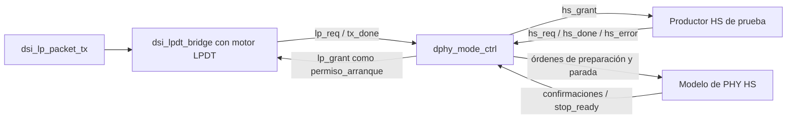

# dphy_mode_ctrl

**RTL implementado desde flujo, datapath y FSM.** Las transiciones de estado
usan `posedge`, las salidas de la FSM son combinacionales y los siete bits
del datapath usan `negedge`. La UC conserva la acción decidida hasta ese flanco.

Diagrama editable: [DPHY_MODE_CTRL.drawio](docs/DPHY_MODE_CTRL.drawio).
[PDF completo, nueve páginas](docs/DPHY_MODE_CTRL.pdf).
Vistas: [arbitraje general](docs/flujo_general.svg),
[LPDT](docs/flujo_lpdt.svg), [HS](docs/flujo_hs.svg) y
[reset/fallos](docs/flujo_recuperacion.svg).
Datapath: [arbitraje y rearme](docs/datapath_arbitraje.svg),
[fallos, fin y salidas](docs/datapath_salidas.svg),
[PDF de las dos páginas](docs/DATAPATH.pdf).
La [justificación del datapath](docs/datapath.md) detalla registros, MUX y
señales hacia la unidad de control.
FSM: [transiciones normales](docs/fsm.svg),
[prioridades y controles](docs/fsm_control.svg),
[PDF de las dos páginas](docs/FSM.pdf) y
[tabla de transiciones y reglas](docs/fsm.md).
Contrato entre flancos: [diagrama](docs/temporizacion.svg),
[PDF](docs/CONTRATO_TEMPORAL.pdf) y [explicación](docs/contrato_temporal.md).
La [guía del diagrama](docs/README.md) explica su alcance y recorrido.

Primera versión de simulación del árbitro LPDT/HS. Reserva el enlace para un
solo productor, ordena preparación/parada de reloj y datos HS y gestiona fallos.
LPDT se prueba con el generador corto, el puente y el motor reales del proyecto;
HS utiliza un modelo funcional de PHY, sin serializador ni pads.

## Alcance del protocolo

La separación de responsabilidades sigue la propuesta `dphy_mode_ctrl` del
[documento de arquitectura objetivo](../docs/referencias/arquitectura_2026_11_08/ARQUITECTURA_OBJETIVO.md)
(§3.5 y plan de migración fase 4). Esta versión implementa arbitraje y secuencia de órdenes.
Las confirmaciones del modelo representan fases completas: **no implementan
todavía Prepare/Zero/Trail/Exit eléctricos ni prueban cumplimiento D-PHY**.
Los tiempos normativos, dominios HS y política de clock lane del panel siguen
pendientes. No hay instancias Gowin, asignaciones de pines ni integración LiteX.



## Algoritmo y arbitraje

1. Esperar `stop_ready`: la PHY de prueba confirma reposo de las tres lanes.
2. Aceptar una solicitud por `req && req_ready`. LP es elegible sin PLL;
   HS requiere `pll_locked && hs_data_ready && !hs_error`.
3. Si ambas son elegibles, alternar: tras atender LP se prefiere HS y viceversa.
   Tras reset se prefiere LP. Una solicitud no elegible no bloquea la otra.
4. LP recibe `lp_grant` hasta `lp_done`; luego se espera reposo antes de
   activar `lp_complete` y admitir otro dueño.
5. HS prepara primero reloj y después datos. Solo entonces recibe `hs_grant`.
   Tras `hs_done`, parar primero datos, después reloj y esperar reposo antes
   de activar `hs_complete`.
6. Pérdida de PLL o `hs_error` durante cualquier fase HS aborta sin éxito y
   mantiene `phy_abort` hasta limpiar el fallo con `clear_error && stop_ready`.

Cada solicitud debe observarse baja en un `negedge` antes de poder aceptarse de nuevo.
El controlador recuerda cuál ya fue consumida: mantener `req=1` no duplica una
transacción ni provoca un reintento automático tras fallo. No hay cola interna;
una solicitud que espera debe conservarse hasta su handshake.

## Interfaz

Las solicitudes y confirmaciones se deciden en `posedge`; el rearme observa
`req=0` en `negedge`. Reloj de prueba: 40 MHz. No se añaden CDC. El reset debe
cubrir ambos flancos. Cada señal tiene un bit salvo `error_code[1:0]`.

| Señal | Dirección | Contrato |
|---|---|---|
| `clk`, `rst` | Entrada | Reset interno activo en alto, registros síncronos |
| `lp_req`, `hs_req` | Entrada | Solicitudes conservadas hasta aceptación |
| `lp_req_ready`, `hs_req_ready` | Salida | Handshake de reserva, solo en reposo y como máximo uno activo |
| `lp_grant` | Salida | Permiso sostenido para el motor LPDT durante su propiedad |
| `hs_grant` | Salida | Permiso sostenido de transferencia HS tras preparar reloj y datos |
| `lp_done`, `hs_done` | Entrada | Pulsos de fin del productor, solo válidos en su fase de transferencia |
| `hs_data_ready` | Entrada | Datos HS reservados; mantener hasta recibir `hs_grant` |
| `pll_locked` | Entrada | PLL disponible; obligatorio durante toda la operación HS |
| `hs_error` | Entrada | Fallo del productor/modelo HS; no se interpreta durante LP |
| `clk_start_req`, `data_start_req` | Salida | Órdenes sostenidas de preparar/mantener reloj y datos HS |
| `clk_prepared`, `data_prepared` | Entrada | Preparación completa de la fase solicitada |
| `data_stop_req`, `clk_stop_req` | Salida | Órdenes sostenidas de finalizar datos y luego reloj |
| `data_stopped`, `clk_stopped` | Entrada | Parada completa de la fase solicitada |
| `stop_ready` | Entrada | Confirmación de reposo completo, con las esperas requeridas ya satisfechas |
| `lp_complete`, `hs_complete` | Salida | Pulsos de negedge a negedge, desde el primer negedge tras liberar el enlace |
| `busy` | Salida | Operación o fallo activo; en reposo sin confirmación no acepta, aunque `busy=0` |
| `error`, `error_code[1:0]` | Salida | error refleja FAULT tras posedge; causa válida desde el negedge posterior: 0 ninguna, 1 PLL, 2 productor HS, 3 estado inválido |
| `phy_abort` | Salida | Petición de abortar al modelo, activa durante reset o fallo |
| `clear_error` | Entrada | Limpia fallo únicamente con reposo confirmado |

`req_ready` ya incorpora arbitraje y disponibilidad: no es una capacidad
genérica del puerto, y es cero sin solicitud. La reserva sucede en un flanco;
el grant aparece después de ese flanco para LP o después de las confirmaciones
de preparación para HS. `grant` no es un pulso de aceptación ni un OE eléctrico.

Las órdenes de preparación se mantienen durante transferencia; una confirmación
alta no inicia nuevas operaciones por sí sola. El modelo conserva el estado
preparado hasta recibir parada/aborto. Debe limpiar sus confirmaciones cuando
corresponda y entregar cada ACK para la orden vigente. Confirmaciones ajenas a
la fase actual y `done` fuera de transferencia se ignoran.

`hs_data_ready` se comprueba al reservar y antes de conceder transferencia.
Si baja durante preparación se espera, sin pausar una transferencia ya iniciada.
Durante `hs_grant` no se interpreta como backpressure: el productor debe
mantener continuidad o avisar con `hs_error`. Las solicitudes LP no interrumpen
HS y las HS no interrumpen LP. No hay timeout; una confirmación ausente mantiene
la fase hasta reset o, durante HS, fallo.

## Datapath y FSM

El datapath propuesto contiene siete bits: preferencia [1], rearme LP/HS [2],
causa de fallo [2] y pulsos de fin [2]. El registro de fase pertenece a la
unidad de control; la FSM propone diez estados con codificación binaria de
cuatro bits. No hay almacén de
paquetes, ECC/CRC ni temporizadores eléctricos. Los estados de la tabla
siguiente se detallan en el diagrama FSM y conservan los nombres del prototipo.

Para mantener la acción entre flancos, UC añade `ACTION[3:0]` junto a
`STATE[3:0]`: ocho bits de control y siete de datapath, quince bits lógicos.
El cambio de fase y de acción es secuencial; todas las salidas de UC se
decodifican en `always @(*)`. No se calcula `next_state` combinacional.

| Fuente | Responsabilidad |
|---|---|
| [dphy_mode_ctrl.v](src/dphy_mode_ctrl.v) | Conexión estructural de UC y datapath; conserva puertos públicos |
| [mode_control.v](src/mode_control.v) | Transiciones y acción en posedge; salidas combinacionales |
| [mode_datapath.v](src/mode_datapath.v) | M0–M4, siete bits de datos, arbitraje y protección |
| [mode_register.v](src/mode_register.v) | Registro con enable y reset síncrono en negedge |
| [mode_mux.v](src/mode_mux.v) | Selector combinacional parametrizable |

| Estado | Salidas activas | Avance |
|---|---|---|
| `IDLE` | `req_ready` del ganador elegible | Reserva LP o HS |
| `LP_OWNED` | `lp_grant` | `lp_done` → `LP_RETURN` |
| `LP_RETURN` | — | `stop_ready` → `IDLE`, `lp_complete` |
| `HS_CLK_PREPARE` | `clk_start_req` | `clk_prepared` → preparar datos |
| `HS_DATA_PREPARE` | `clk_start_req`, `data_start_req` | `data_prepared && hs_data_ready` → transferir |
| `HS_TRANSFER` | `clk_start_req`, `data_start_req`, `hs_grant` | `hs_done` → parar datos |
| `HS_DATA_STOP` | `clk_start_req`, `data_stop_req` | `data_stopped` → parar reloj |
| `HS_CLK_STOP` | `clk_stop_req` | `clk_stopped` → esperar reposo |
| `HS_RETURN` | — | `stop_ready` → `IDLE`, `hs_complete` |
| `FAULT` | `error`, `phy_abort` | `clear_error && stop_ready` → `IDLE` |

Reset bloquea combinacionalmente grants, handshakes y órdenes; pide aborto.
En posedge borra estado y acción; en negedge, causa, pulsos y memoria del datapath.
En cualquier estado HS, PLL perdido
o `hs_error` retira combinacionalmente grants/órdenes y pide aborto; el siguiente
posedge registra FAULT y la causa seleccionada en ACTION; el siguiente negedge
captura el código. PLL tiene prioridad si ambos fallos coinciden.
Los receptores de `phy_abort` deben resetearse/recuperarse también; quitar el
grant no deshace por sí solo una transmisión física.

## Verificación

```sh
pixi run --locked check-rtl
pixi run --locked test-dphy-mode
pixi run --locked make -C dphy_mode_ctrl waves
```

La prueba unitaria observa puertos públicos y controla las confirmaciones:
exclusión LP/HS, alternancia, solicitudes mantenidas, elegibilidad, confirmaciones
demoradas, finalización después del reposo, ausencia de interrupción HS,
PLL/fallo HS y recuperación, reset en cada fase. La prueba integrada conecta
el generador y el puente reales con un modelo HS de latencia variable; comprueba
el paquete LPDT reconstruido desde D0 y la exclusión durante ambas operaciones.
El modelo HS no produce bits ni acredita capacidad de transmisión de vídeo.
La prueba entre flancos añade captura de causas y aceptaciones con entradas
que cambian después de posedge, pulsos completos, reset de acciones pendientes
y los seis códigos no usados. La unitaria comprueba que ningún registro del
datapath cambie en posedge ni la memoria de UC en negedge.

Resultado local (2026-11-08):

| Comprobación | Resultado |
|---|---|
| `check-rtl` | PASS, incluidos controlador y puente |
| Prueba unitaria de modos | PASS: seis LP y cinco HS completos, 12 fallos por fase, 34 resets |
| Prueba integrada | PASS: ocho paquetes LPDT reconstruidos y ocho operaciones HS simuladas, cuatro latencias PHY |
| Prueba entre flancos | PASS: 13 casos de retención, reset y códigos 10–15 |
| Yosys `proc; check -assert` | PASS: sin latches, UC en posedge y registros del datapath en negedge |
| Regresión del puente | PASS: 26 paquetes, siete rechazos y siete abortos en D0 |
| Regresiones de preparadores | PASS: 65.815 paquetes cortos y 311 largos completos |
| Ondas de las tres pruebas | VCD generado correctamente |

Icarus conserva los avisos de `timescale` heredado en las fuentes originales
del motor LPDT. El controlador aislado elabora sin esos avisos.

Productos en `build/dphy_mode_ctrl/`. Las tareas no programan hardware.
Para revertir, retirar este directorio, sus tareas/enlaces y la salida adicional
`lp_req` del puente; el datapath del puente y del motor permanecen iguales.
