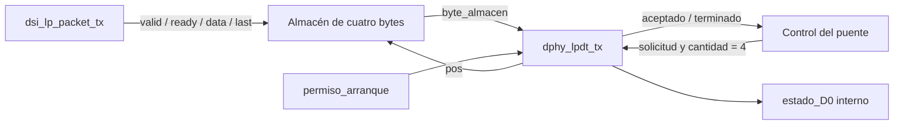

# dsi_lpdt_bridge

Puente de prueba entre `dsi_lp_packet_tx` y `dphy_lpdt_tx`. Recibe exactamente
cuatro bytes DSI y contiene una instancia del motor LPDT existente. Permite
simular comandos cortos completos hasta los estados lógicos de D0, sin LiteX
ni E/S del panel. No admite paquetes largos.

## Contrato y recorrido

El productor entrega `Data ID`, `Data 0`, `Data 1`, `ECC`, con `last` únicamente
en el cuarto byte. El puente no interpreta ni calcula esos campos: conserva
los bytes recibidos. El motor añade por sí mismo el selector LPDT `87`.
Referencia del contrato: [preparador corto](../dsi_lp_packet_tx/README.md),
[puertos del motor](../dphy_lpdt_tx/src/dphy_lpdt_tx.v) y
[control del motor](../dphy_lpdt_tx/src/lpdt_control.v).



1. Capturar un byte solo con `tx_byte_valid && tx_byte_ready`.
2. Esperar cuatro bytes y comprobar la posición de `last`.
3. Solicitar el arranque hasta observar `aceptado`. El motor comprueba permiso.
4. Mantener inmutable el almacén; responder combinacionalmente a `pos`.
5. Esperar `terminado`, liberar el almacén y emitir `tx_done` durante un ciclo.

## Interfaz

| Señal | Dirección | Anchura | Semántica |
|---|---|---:|---|
| `clk` | Entrada | 1 | Reloj de control previsto: 40 MHz |
| `rst` | Entrada | 1 | Reset interno activo en alto; mantener durante ambos flancos |
| `tx_byte_data` | Entrada | 8 | Byte DSI ya preparado |
| `tx_byte_valid` | Entrada | 1 | El productor mantiene dato y `last` hasta aceptación |
| `tx_byte_last` | Entrada | 1 | Fin de paquete, significativo con `valid` |
| `tx_byte_ready` | Salida | 1 | Acepta bytes durante captura o descarte |
| `permiso_arranque` | Entrada | 1 | Permiso lógico de inicio para el motor; no habilita pads |
| `lp_req` | Salida | 1 | Paquete completo esperando aceptación del motor; permite solicitar propiedad al árbitro |
| `busy` | Salida | 1 | Desde el primer byte aceptado hasta fin o descarte |
| `tx_done` | Salida | 1 | Pulso registrado después de `terminado`, con D0 ya en LP-11 |
| `packet_error` | Salida | 1 | Pulso registrado al detectar `last` fuera del cuarto byte |
| `estado_D0` | Salida | 2 | Estados lógicos internos, bit 1=P y bit 0=N |

Los registros del puente y sus handshakes usan `posedge`. El motor conserva
su control en `posedge` y su datapath en `negedge`. La lectura del almacén es
combinacional, como requiere `byte_almacen`; no se sustituye por RAM de lectura
síncrona. Los caminos de medio ciclo necesitan STA si se implementa en FPGA.

Después del cuarto byte, `ready=0` durante espera de permiso, aceptación y
transmisión. Un productor puede mantener pendiente el siguiente paquete;
no se acepta ningún byte suyo hasta liberar el almacén. `busy=0` mientras
espera el primer byte. No hay aceptación simultánea del siguiente paquete
en el flanco que observa `terminado`; sí en el siguiente flanco.

`tx_done` corresponde al envío LPDT local, no al `packet_done` del generador
ni a una confirmación del panel. Bajar permiso después de la aceptación no
interrumpe el motor. No hay timeout de recepción ni de espera de permiso.

Para la prueba con [dphy_mode_ctrl](../dphy_mode_ctrl/README.md), `lp_req`
solicita propiedad, `lp_grant` se conecta a `permiso_arranque` y `tx_done` a
`lp_done`. `lp_req` baja cuando el motor acepta; `busy` también incluye la
captura parcial y por eso no se usa como solicitud al árbitro.

## Datapath y FSM

Datapath: registro de 32 bits, índice de escritura de dos bits, selección
combinacional de uno de cuatro bytes por `pos[2:0]` (cero fuera de rango).
La longitud conectada al motor es constante, `3'd4`.

| Estado | Operación | Transición |
|---|---|---|
| `COLLECT` | `ready=1`; guardar cada byte aceptado | Cuarto byte con `last`: `REQUEST` |
| `REQUEST` | `ready=0`; solicitud activa, almacén estable | `aceptado`: `TRANSMIT` |
| `TRANSMIT` | `ready=0`; almacén estable | `terminado`: `COLLECT`, pulso `tx_done` |
| `DRAIN` | `ready=1`; descartar bytes | Byte aceptado con `last`: `COLLECT` |

Un `last` temprano descarta el paquete y activa `packet_error`, quedando listo
para otro paquete. Un cuarto byte sin `last` activa `packet_error` y pasa a
`DRAIN`: se descarta hasta recibir un `last` aceptado. Ningún paquete inválido
arranca el motor. Si nunca llega `last`, se necesita reset para salir de descarte.

Reset bloquea combinacionalmente `ready` y la solicitud; en `posedge` borra
almacén, índice, estado y pulsos, abortando sin éxito ni error. El motor vuelve
a LP-11 en `negedge`. Se debe mantener reset al menos un ciclo completo. Un
productor conectado debe resetearse también para descartar el mismo paquete.

## Pruebas y uso

```sh
pixi run --locked check-rtl
pixi run --locked test-dsi-lpdt-bridge
```

Con Icarus, VVP y Make disponibles también se puede ejecutar
`make -C dsi_lpdt_bridge test`. Productos en `build/dsi_lpdt_bridge/`.
`make -C dsi_lpdt_bridge waves` guarda además las ondas VCD del testbench.

El testbench conecta el generador corto real y permite inyectar bytes para
probar pausas y paquetes inválidos. Un monitor observa solo `estado_D0`:
reconoce Escape Entry/Exit, reconstruye bytes LSB primero y mide cuatro ciclos
por fase del motor actual. Compara el selector `87` y los cuatro bytes con
vectores fijos. También verifica backpressure, permiso demorado/retirado,
comandos consecutivos, reset durante captura/espera/transmisión/finalización,
errores de longitud y recuperación. No depende de estados internos del RTL.

Resultado local (2026-11-08): elaboración PASS; simulación PASS con 26 paquetes
LPDT completos, siete rechazos y siete abortos observados en D0. También pasan
las regresiones existentes de paquetes cortos (65.815 completos, ocho abortos)
y largos (311 completos, 22 abortos). La generación opcional de VCD fue probada.
Icarus avisa que los módulos originales del motor heredan el `timescale` del
puente; no se modificaron esos módulos.

Esta prueba no valida temporización normativa D-PHY, timing físico, voltajes
ni recepción del LCD. El target de depuración y sus fuentes no se modifican.
Para retirar esta prueba basta quitar su directorio y sus tareas/enlaces.
