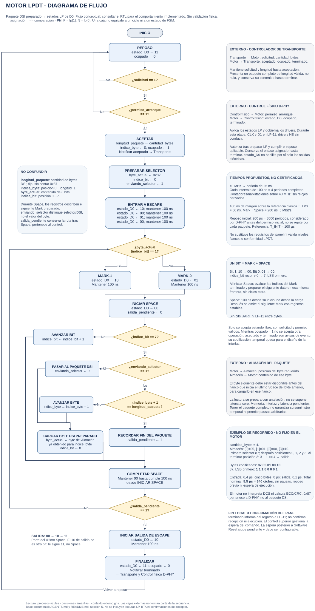
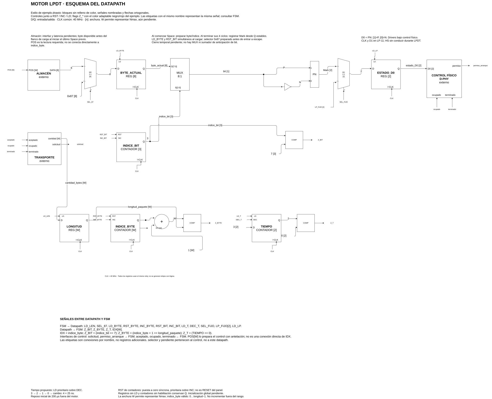
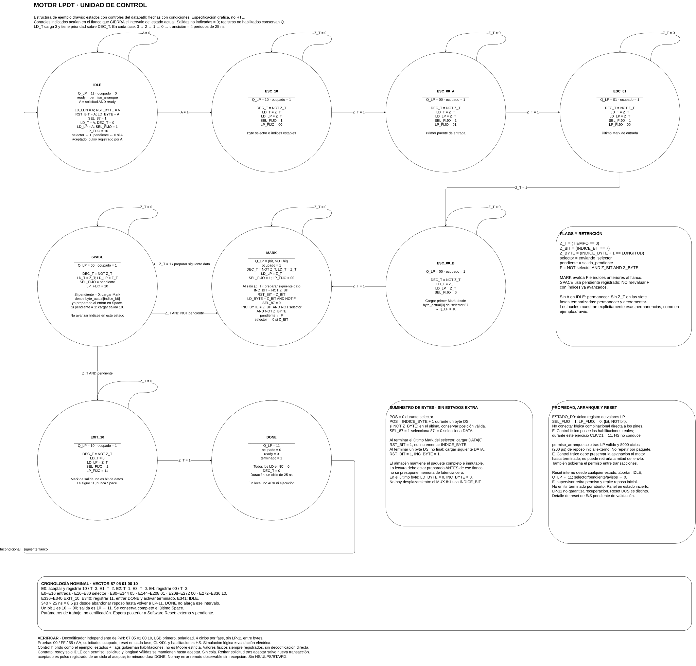

# RTL: motor LPDT

[Inicio](../README.md) · [Protocolo y tiempos](docs/lpdt.md) · [Pruebas](TB/README.md)

```text
src/      Módulos Verilog del diseño
TB/       Testbenches <modulo>_TB.v
waves/    Vistas GTKWave versionadas
build/    Productos de simulación ignorados por Git
docs/     Protocolo y diagramas (fuente drawio y vistas SVG)
```

## Para qué sirve

Este es el motor de transmisión LPDT: recibe un paquete preparado de 1–7 bytes,
añade el selector `87` y produce los estados lógicos del par D0 hasta volver
al reposo. No genera imagen, ECC/CRC ni señales eléctricas para el panel.
RTL es la descripción de registros y lógica; aquí está escrita en Verilog.
La FSM (máquina de estados) coordina el datapath, los registros y contadores
que almacenan y desplazan los datos.

Los README de [fuentes](src/README.md), [pruebas](TB/README.md),
[ondas](waves/README.md) y [documentos](docs/README.md) explican cada carpeta.
Para LiteX y la FPGA, consultar el [flujo general](../docs/flujo_de_trabajo.md).
Los términos se explican en la [arquitectura](../docs/arquitectura.md).

## Simulación

Requisitos: `make`, Icarus Verilog (`iverilog`, `vvp`) y, para ondas, `gtkwave`.
Desde la raíz del repositorio, el entorno reproducible permite `pixi run test`
para las cinco pruebas. Dentro de `pixi shell`, o con herramientas del sistema:

```sh
make -C motor_lpdt test            # Compilar y ejecutar sin GUI
make -C motor_lpdt sim             # Ejecutar y abrir GTKWave con su vista
make -C motor_lpdt wave            # Abrir el VCD existente, sin regenerarlo
make -C motor_lpdt test-all        # Todas las pruebas
make -C motor_lpdt clean           # Eliminar .out y .vcd generados
```

El target por defecto es `motor_lpdt`. Para bloques auxiliares, usar
`TARGET=count`, `reg`, `mux` o `motor_control` (por ejemplo, `TARGET=reg`).
El Makefile selecciona sus dependencias; `OBJS="src/top.v src/otro.v"` permite
reemplazarlas. Las simulaciones se ejecutan dentro de `build/`.

Los `.gtkw` guardan selección, formato y agrupación de señales, **no sus datos**.
Se suben a Git sin `.out` ni `.vcd`: tras clonar, `sim` genera ambos y abre la
vista. `wave` requiere que el VCD ya exista. Este Makefile solo simula;
la síntesis del motor integrado se realiza desde [gateware](../gateware/README.md).

## Contrato de `motor_lpdt`

| Señal | Uso |
|---|---|
| `clk` | 40 MHz; control en posedge, datapath en negedge |
| `rst` | Reset interno; mantener durante un posedge y el negedge siguiente |
| `permiso_arranque` | Autoriza aceptar; presupone reposo y drivers preparados |
| `solicitud` | Petición por nivel, muestreada en posedge cuando está en IDLE |
| `cantidad_bytes[2:0]` | 1–7 bytes, sin contar el selector `87`; cero se rechaza |
| `pos[2:0]` | Dirección anticipada del almacén externo |
| `byte_almacen[7:0]` | Byte solicitado; debe estar estable antes del negedge de carga |
| `aceptado` | Pulso de un ciclo al aceptar la petición |
| `ocupado` | Transacción en curso |
| `terminado` | Pulso de un ciclo después del retorno efectivo a LP-11 |
| `estado_D0[1:0]` | Salida lógica: bit 1 = P, bit 0 = N |

Preparar el paquete completo, con ECC/CRC cuando corresponda, antes de solicitar.
Mantener longitud estable desde el posedge de aceptación hasta el negedge de
captura siguiente, y el paquete inmutable hasta terminar o abortar con reset.
El almacén no tiene handshake: se prueba lectura síncrona en posedge, pero no
se admite cualquier latencia. Las entradas deben ser síncronas; no hay CDC.

Retirar `solicitud` tras `aceptado` para evitar repetir el envío: las peticiones
durante ocupado no se encolan, pero una petición aún activa al volver a IDLE
puede aceptarse de nuevo. Retirar el permiso no aborta un envío en marcha.

`terminado` aparece en el posedge posterior al negedge que carga LP-11
(12,5 ns después); entonces baja `ocupado`. No confirma recepción ni ejecución
DCS. El reset aborta sin emitir `terminado`; el supervisor debe gestionar la
recuperación. Antes del reset no se garantiza una salida LP conocida.

## Límites actuales

Tiempos fijos de cuatro ciclos por fase. No incluye reposo inicial, esperas DCS,
control eléctrico de drivers, CLK/D1, recepción, BTA ni generación de paquetes.
Los caminos de medio ciclo requieren análisis temporal antes de usar la FPGA.

## Diagramas

Fuente editable: [MOTOR_LPDT.drawio](docs/MOTOR_LPDT.drawio).
También disponible como [PDF de tres páginas](docs/MOTOR_LPDT.pdf).
Los SVG se visualizan en GitHub; abre una imagen para verla a tamaño completo.
Son diagramas de diseño: el flujo es conceptual y no sustituye el contrato RTL.

Para actualizar las vistas con Draw.io Desktop y Poppler (`pdftocairo`), desde
la raíz (no son necesarios para simular):

```sh
drawio -x -f pdf -a --crop --theme light -o motor_lpdt/docs/MOTOR_LPDT.pdf motor_lpdt/docs/MOTOR_LPDT.drawio
pdftocairo -svg -f 1 -l 1 motor_lpdt/docs/MOTOR_LPDT.pdf motor_lpdt/docs/flujo.svg
pdftocairo -svg -f 2 -l 2 motor_lpdt/docs/MOTOR_LPDT.pdf motor_lpdt/docs/datapath.svg
pdftocairo -svg -f 3 -l 3 motor_lpdt/docs/MOTOR_LPDT.pdf motor_lpdt/docs/fsm.svg
```

El paso por PDF convierte los textos a trazos SVG, sin depender de etiquetas HTML.

### Flujo



### Datapath



### FSM


