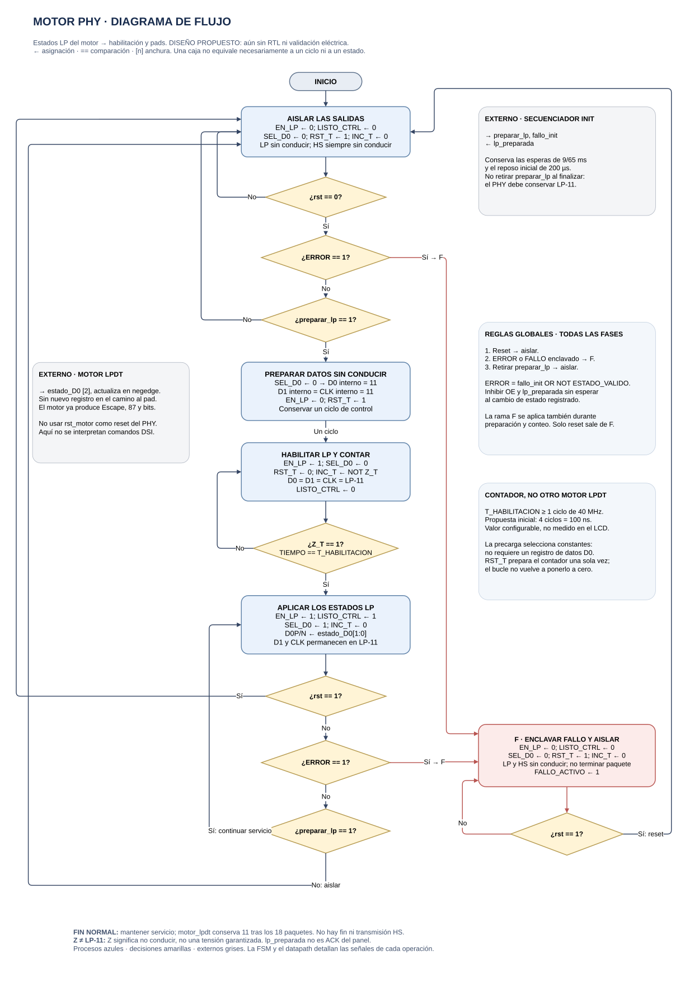

# motor_phy: interfaz lógica de preparación LP

[Inicio](../README.md) · [Diagramas](docs/README.md) ·
[Hardware](../docs/hardware.md)

**RTL lógico implementado; adaptador de pads en Migen/LiteX;
validación eléctrica pendiente.** Ver [integración](../gateware/README.md).
Su alcance es exclusivamente LP de transmisión para la inicialización capturada.
No implementa HS, BTA, recepción, detección de alimentación ni LiteX.

## Separación de responsabilidades

```text
secuenciador_init ─ preparar_lp ──► motor_phy
                 ◄ lp_preparada ──┘
                 ─ fallo ───────► inhibición / FALLO

motor_lpdt ─ estado_D0[1:0] ─────► selección LP ─► buffers Gowin ─► panel
                                                   │
                                   ramas HS siempre deshabilitadas
```

El motor LPDT genera Escape, bits y retorno a LP-11. `motor_phy` solamente
prepara y habilita los drivers, transmite esos estados y mantiene D1/CLK
en LP-11. No genera paquetes, esperas de 9/65 ms, ECC ni CRC.

## Organización

| Ruta | Responsabilidad |
|---|---|
| `docs/MOTOR_PHY.drawio` | Fuente editable: flujo, bloques y FSM |
| `docs/MOTOR_PHY.pdf` | Exportación de las tres páginas |
| `docs/flujo.svg` | Flujo de preparación y servicio |
| `docs/datapath.svg` | Integración, selección de niveles y buffers |
| `docs/fsm.svg` | Estados, salidas y prioridades |
| `src/` | Top, FSM, máscara y concatenación; reutiliza contador, comparador y MUX de `motor_lpdt` |
| `TB/` | Testbench del PHY lógico con modelo de pads y plan de integración |
| `Makefile` | Pruebas con `T_HABILITACION` = 1, 2, 4, 7 y 8 |

## Interfaz del RTL

| Señal | Dirección | Contrato |
|---|---|---|
| `clk` | Entrada | 40 MHz para la preparación; no es el reloj HS |
| `rst` | Entrada | Reset global coordinado; forzar aislamiento mientras esté activo |
| `preparar_lp` | Entrada | Petición mantenida del secuenciador |
| `fallo_init` | Entrada | Conectar a `secuenciador_init.fallo`; inhibir salidas y enclavar FALLO |
| `estado_D0[1:0]` | Entrada | `{D0P,D0N}`, generado por el motor LPDT |
| `lp_preparada` | Salida | Preparación local completada; no es ACK ni medida de tensión |
| `lp_p[2:0]`, `lp_n[2:0]` | Salida interna | Datos hacia los buffers LP, orden de bits D0, D1, CLK |
| `lp_oe[2:0]` | Salida interna | Habilitación positiva de cada par LP |
| `hs_oen[2:0]` | Salida interna | Siempre `111`: buffers HS deshabilitados, polaridad física Gowin |

El adaptador `gateware/cores/phy_pads.py` convierte `lp_oe` a `OEN=~lp_oe` para los TBUF.
Los buffers diferenciales HS deben tener su `OEN=1` real; fijar sus datos a
cero no los deshabilita. La elección final de primitivas y restricciones de
E/S se comprueba digitalmente para GW2AR-18C, pero requiere revisión eléctrica
antes de generar o cargar un bitstream.

**No conectar `rst_motor` como reset del PHY.** Es el reset/aborto del motor
LPDT, no la orden de habilitación de los pads. El PHY usa reset global y
`fallo_init` explícitos para que su comportamiento sea independiente.
`terminado` no es necesario en este bloque: lo consume el secuenciador.

## Flujo y estados



| Estado | LP | D0 | D1 / CLK | `lp_preparada` |
|---|---|---|---|---:|
| AISLADO | Deshabilitado (Z) | Dato interno `11` | Dato interno `11` | 0 |
| PRECARGAR | Deshabilitado (Z) | Precargar `11` | Precargar `11` | 0 |
| ESTABILIZAR | Habilitado | `11` | `11` | 0 |
| LISTO | Habilitado | `estado_D0` | `11` | 1 |
| FALLO | Deshabilitado (Z) | Dato interno `11` | Dato interno `11` | 0 |

En **todos** los estados HS permanece deshabilitado.
Z significa que el buffer deja de conducir: no garantiza tensión alta
en el conductor, porque existen el panel, pulls y la red externa.

Prioridades de la FSM:

1. `rst=1`: AISLADO, retirar preparación y deshabilitar todos los buffers.
2. `fallo_init=1`, estado no válido o FALLO ya enclavado: FALLO hasta reset.
3. `preparar_lp=0`: AISLADO, sin completar automáticamente un paquete.
4. Con petición activa: AISLADO → PRECARGAR → ESTABILIZAR → LISTO.
5. Las transiciones anteriores nunca autorizan drivers desde un estado no válido.

PRECARGAR dura un ciclo de control con los buffers LP aún deshabilitados.
ESTABILIZAR mantiene LP-11 durante `T_HABILITACION >= 1` ciclos completos
antes de declarar LISTO. **Se propone inicialmente 4 ciclos (100 ns),**
configurables; no es una temporización medida ni una certificación D-PHY.
El timeout de preparación de 1 ms del secuenciador debe superar este proceso.
Su reposo inicial de 200 µs permanece separado y no se elimina.

El reset, fallo o retirada de petición deben enmascarar habilitaciones y
`lp_preparada` sin esperar al cambio de estado registrado. Esto no constituye
una garantía analógica de latencia cero: deben analizarse los caminos de
inhibición, sincronización y recuperación del reset durante la implementación.
Las entradas funcionales pertenecen al mismo dominio de 40 MHz.

## Camino de datos sin nueva latencia

Los diagramas descomponen el bloque con las mismas convenciones de los otros
módulos. La FSM usa `rst_t`, `inc_t`, `en_lp`, `sel_d0` y
`listo_ctrl`; el contador `TIEMPO[W]` y comparador devuelven `z_t`.
El control cambia de estado en posedge y el contador en negedge, reutilizando `count.v`
y `comp.v`. El contador compara contra N (no N−1) y la FSM observa el flag
en el posedge posterior, para completar N ciclos de LP-11.
`W=max(1,ceil(log2(N+1)))`, con N≥1.

Las habilitaciones efectivas se enmascaran mediante:

```text
B = preparar_lp & !rst & !fallo_init & ESTADO_VALIDO & !FALLO_ACTIVO
HAB_LP = EN_LP & B
lp_preparada = LISTO_CTRL & B
S_mux = SEL_D0 & B
```

`ESTADO_VALIDO` y `FALLO_ACTIVO` se decodifican del estado de la FSM;
no son sensores, respuestas del panel ni registros extra del datapath.
Los estados anteriores ya definen esta política: la descomposición muestra
qué bloque realiza cada operación, sin cambiar el alcance funcional.

En LISTO:

```text
lp_p = {1, 1, estado_D0[1]}    // CLK_P, D1_P, D0_P
lp_n = {1, 1, estado_D0[0]}    // CLK_N, D1_N, D0_N
lp_oe = 111
hs_oen = 111                  // activo bajo: HS apagado
```

El camino `estado_D0 → selección → buffer` no añade un registro ni vuelve
a muestrear D0 en posedge. El motor ya actualiza D0 en negedge. Añadir una
etapa cambiaría la relación entre la salida física y `terminado`, invalidando
la interpretación temporal de las pruebas actuales.

Fuera de LISTO, los datos internos LP se fuerzan a unos; solo ESTABILIZAR
los conduce. AISLADO, PRECARGAR y FALLO mantienen los buffers en Z.
Al completar normalmente la inicialización **no se deshabilita el PHY**:
`preparar_lp` sigue alto, el motor mantiene `11` y el panel ve LP-11.
Un fallo tiene una política diferente: abortar y dejar de conducir, no
pretender terminar el paquete ni prometer LP-11 después del aborto.

## Mapa físico a conservar

**Pines de FPGA, no contactos del conector LCD.**

| Par | LP P / N (100 Ω por rama) | HS P / N |
|---|---|---|
| D0 | 122 / 123 | 117 / 116 |
| D1 | 124 / 125 | 115 / 114 |
| CLK | 126 / 128 | 113 / 112 |

Las seis ramas LP pertenecen al banco medido a 1,21 V; las HS, al banco
medido a 2,52 V. Esas medidas no validan la señal en el panel.
No usar LVCMOS33 para LP ni modificar las resistencias de 100 Ω.
Revisar los pulls durante configuración: el RTL todavía no tiene control
de los pads antes de que termine la configuración de la FPGA.

## Antes de implementar en placa

Desde la raíz:

```sh
make -C motor_phy test-all
```

Las pruebas cubren temporización, datos sin latencia, reset, retirada de petición,
fallo enclavado y estados inválidos. La comprobación RTL con Yosys no infiere
latches y pasa `check -assert`. El top no instancia primitivas de E/S;
`lp_oe` es positivo y `hs_oen` es activo bajo.

El [plan de pruebas](TB/README.md) aún debe comprobar primitivas reales, orden
de pines, las cinco situaciones de estado y la secuencia completa desde
los pads simulados. Después hacen falta restricciones y cierre temporal
de la ruta a pads y revisión eléctrica.

Los diagramas no son autorización para programar la placa ni prueba de
que el panel haya recibido la inicialización.
