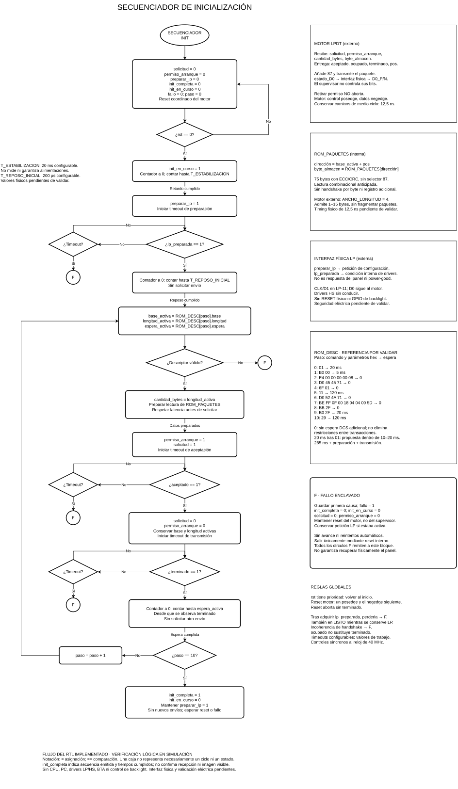
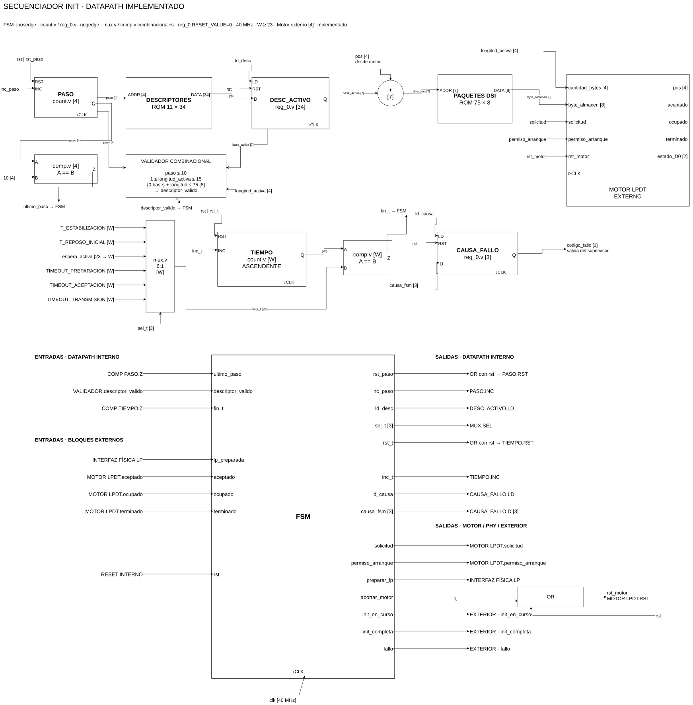
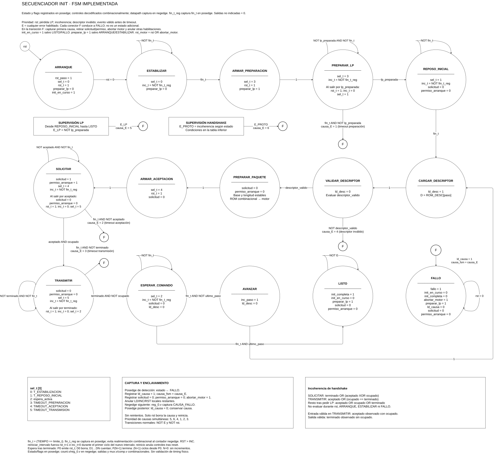

# Secuenciador autónomo de inicialización

[Inicio](../README.md) · [Pruebas](TB/README.md) · [Diagramas](#diagramas)

Emite automáticamente 11 comandos DCS tras reset, sin CPU, PC ni LiteX.
`src/secuenciador_init.v` conecta el datapath y la FSM; el motor LPDT es externo.

| Carpeta | Contenido |
|---|---|
| [src/](src/README.md) | Top, FSM, ROM de descriptores/paquetes y validador |
| [TB/](TB/README.md) | Prueba de control con fallos y prueba integrada con motor real |
| [docs/](docs/README.md) | Fuente Draw.io y vistas de flujo, datapath y FSM |
| [waves/](waves/README.md) | Vistas GTKWave; no contienen datos de simulación |
| `../build/secuenciador_init/` | Ejecutables y ondas generados, ignorados por Git |

## Funcionamiento

```text
PASO[4] → ROM_DESCRIPTORES → DESC_ACTIVO[34]
                              ├→ longitud → motor externo
                              ├→ base + pos → ROM_PAQUETES → byte → motor externo
                              └→ espera → MUX de tiempos → comparador ← TIEMPO[W]

PASO → comparador último paso ──┐
DESC_ACTIVO → validador ────────┼→ secuenciador_control → cargas, resets e incrementos
comparador TIEMPO ─────────────┘          └→ CAUSA_FALLO[3]
```

El flujo sigue siendo: reset → estabilización temporizada → preparación LP →
reposo inicial → descriptor → validación → preparación del paquete → solicitud →
transmisión → espera DCS → siguiente paso o LISTO. Los errores previstos en la
FSM enclavan FALLO, guardan la primera causa y mantienen el reset del motor.

El módulo no instancia el motor LPDT ni la interfaz física. No añade CPU,
CSR, UART, drivers LP/HS, reinicialización externa ni control de backlight.
Los contadores y registros usan negedge; la FSM actualiza sus registros en
posedge y decodifica las salidas en `always @*`.

## Interfaz

| Señal | Dirección | Uso |
|---|---|---|
| `clk`, `rst` | Entrada | Reloj de 40 MHz y reset; mantener rst durante posedge y negedge posterior |
| `lp_preparada` | Entrada | Condición interna de la interfaz física; no es respuesta del panel |
| `preparar_lp` | Salida | Petición a esa interfaz |
| `aceptado`, `ocupado`, `terminado` | Entrada | Handshake desde el motor |
| `pos[3:0]` | Entrada | Dirección anticipada desde el motor |
| `solicitud`, `permiso_arranque` | Salida | Petición de transmisión al motor |
| `cantidad_bytes[3:0]` | Salida | Longitud del descriptor activo, sin selector 87 |
| `byte_almacen[7:0]` | Salida | ROM combinacional en base activa + pos |
| `rst_motor` | Salida | rst OR abortar_motor; conectar al reset del motor |
| `init_en_curso`, `init_completa`, `fallo` | Salida | Estado local del arranque |
| `codigo_fallo[2:0]` | Salida | Primera causa capturada; cero tras reset |

El motor externo debe usar `ANCHO_LONGITUD=4`. No registrar adicionalmente
el camino `pos → suma → ROM → byte_almacen` sin revisar su anticipación.
El presupuesto de medio ciclo de 12,5 ns requiere análisis de implementación.
`init_completa` indica emisión de la secuencia y cumplimiento de sus esperas;
no confirma recepción, ejecución DCS ni imagen visible.

## Parámetros de tiempo

Los valores están expresados en ciclos de 40 MHz. `W=23` por defecto;
usar W ≥ 23 para conservar las esperas de la ROM, y dimensionarlo también
para cualquier parámetro de tiempo que se amplíe. No usar valores negativos
ni que no quepan en W bits: el RTL no comprueba estos errores de configuración.

| Parámetro | Valor por defecto | Tiempo | Evidencia / estado |
|---|---:|---:|---|
| `T_ESTABILIZACION` | 800000 | 20 ms | Valor inicial propuesto aquí; no fijado por la documentación ni validado en placa |
| `T_REPOSO_INICIAL` | 8000 | 200 µs | Propuesta del diagrama, no temporización física validada |
| `TIMEOUT_PREPARACION` | 40000 | 1 ms | Presupuesto inicial propuesto para drivers todavía pendientes |
| `TIMEOUT_ACEPTACION` | 16 | 400 ns | Presupuesto inicial propuesto para el handshake local |
| `TIMEOUT_TRANSMISION` | 2048 | 51,2 µs | Presupuesto inicial propuesto, superior a los 1044 ciclos LP del envío de 15 bytes |

La documentación previa deja pendientes estabilización y timeouts: estos
defaults son configuraciones de trabajo, no requisitos del panel ni prueba
de que los drivers futuros cumplan esos tiempos. El retardo de estabilización
no observa ni garantiza las alimentaciones. No se ha autorizado ninguna
prueba eléctrica como parte de esta integración.

Las esperas DCS no se modifican: la ROM contiene 800000, 200000 y 4800000
ciclos para 20, 5 y 120 ms, respectivamente, y cero para los pasos sin espera
adicional. Acumulan 285 ms, más estabilización, preparación y transmisión.
La FSM observa el fin en posedge y respeta el ciclo adicional descrito en
el diagrama; un valor cero no elimina la preparación entre transacciones.

## Secuencia ROM

Bytes DCS hexadecimales; VC=0. Las esperas son posteriores al envío.
Los paquetes incluyen ECC y, si son largos, CRC; el motor añade el selector `87`.

| Paso | Comando y parámetros | DT | Bytes DSI | Espera |
|---:|---|---|---:|---:|
| 0 | `01` | `05` | 4 | 20 ms |
| 1 | `B0 00` | `15` | 4 | 5 ms |
| 2 | `E4 00 00 00 00 08` | `39` | 12 | 0 |
| 3 | `D0 45 45 71` | `39` | 10 | 0 |
| 4 | `6F 01` | `15` | 4 | 0 |
| 5 | `11` | `05` | 4 | 120 ms |
| 6 | `D0 52 4A 71` | `39` | 10 | 0 |
| 7 | `BE FF 0F 00 18 04 04 00 5D` | `39` | 15 | 0 |
| 8 | `BB 2F` | `15` | 4 | 0 |
| 9 | `B0 2F` | `15` | 4 | 20 ms |
| 10 | `29` | `05` | 4 | 120 ms |

Referencia: drivers will-tm y jamwu para LT031MDZ4000
([revisiones y atribución](docs/referencias.md)); no demuestra compatibilidad con el ejemplar FPGBC.
No se copian sus controles GPIO de reset/backlight: no son accesibles aquí.

`codigo_fallo`: 0=sin fallo, 1=timeout LP, 2=timeout aceptación,
3=timeout transmisión, 4=descriptor inválido, 5=pérdida LP, 6=handshake incoherente.
La primera causa queda enclavada; solo reset reinicia. No hay reintentos automáticos.

## Simulación

```sh
pixi run make -C secuenciador_init test
pixi run make -C secuenciador_init test TARGET=secuenciador_init
pixi run make -C secuenciador_init test-all
pixi run make -C secuenciador_init sim TARGET=secuenciador_init
pixi run make -C secuenciador_init wave TARGET=secuenciador_init
```

La primera prueba usa modelos de datapath y motor para verificar la FSM e
inyectar fallos. La integrada instancia ambas ROM, registros, contadores,
comparadores, validador, FSM y un motor LPDT externo real de cuatro bits.
Reconstruye los 11 paquetes desde D0, compara sus bytes con vectores fijos,
recalcula ECC/CRC y mide las esperas DCS completas. Solo reduce estabilización,
reposo inicial y timeout de preparación en la instancia del testbench.
Comprueba también ausencia de duplicados, pérdida LP en LISTO y reset posterior.

La prueba integrada simula más de 285 ms y puede tardar considerablemente más
que las pruebas de control. `test` no genera ondas para esta prueba.
`sim TARGET=secuenciador_init` activa el volcado completo en FST, un formato
comprimido compatible con GTKWave, y abre su vista de señales, con ambas FSM
en ASCII. `wave TARGET=secuenciador_init` abre el FST existente sin repetir la
simulación. La prueba de control conserva su formato VCD.
Los resultados van a `build/secuenciador_init/`.

Estas pruebas no validan tensiones, D-PHY, timing colocado, alimentación,
recepción del panel ni la compatibilidad de la secuencia ROM con el ejemplar
FPGBC. Tampoco sustituyen todas las inyecciones de fallo con datapath real.
Pendientes: reset y pérdida LP durante cada fase de la integración real,
timeouts integrados y aceptación retrasada con ambas ROM.

## Diagramas

Representan el RTL lógico actual; no certifican la capa eléctrica.
Fuente editable: [SECUENCIADOR_INIT.drawio](docs/SECUENCIADOR_INIT.drawio).
[PDF de tres páginas](docs/SECUENCIADOR_INIT.pdf) · [Regenerar vistas](docs/README.md).

### Flujo



### Datapath



### FSM


